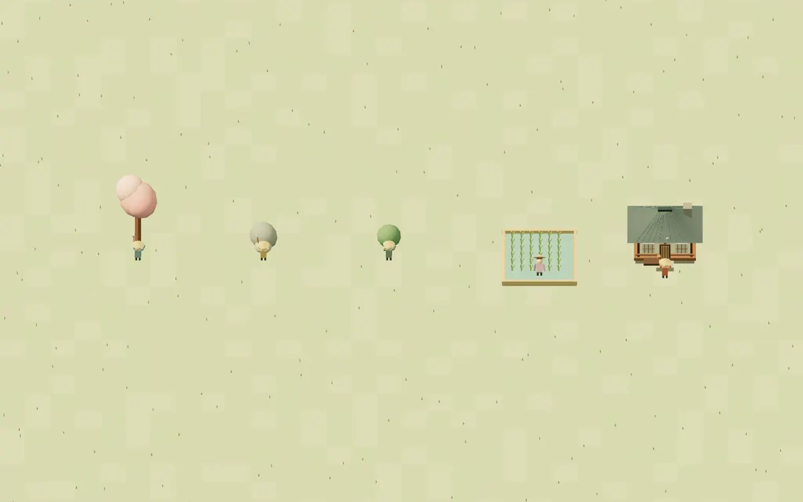

# Villager gathering animations

| Source                      | Activity                                               |
| --------------------------- | ------------------------------------------------------ |
| Trees (all visual variants) | Axe wind-up, chop and torso turn toward the trunk      |
| Stone deposits              | Overhead pickaxe strike with a forward lean            |
| Berry bushes                | Alternating reaches and hand picking                   |
| Rice paddies                | Deep bend and low, two-handed tending inside the paddy |
| Workshops                   | Short mallet strokes with the other arm held steady    |

The hall's passive insight has no assigned worker and needs no gathering animation.

`simulation/work-activity.ts` records successful work after navigation and cargo checks. This evidence is ephemeral: it neither changes production nor enters saves. Assigned orders and human-readable task labels alone do not activate animation. The first successful tick after loading starts a fresh pose.

`game/gathering.ts` handles simulation-time phases, target-facing turns, pause and pose transitions. `art.ts` adds an upper-body pivot and per-villager tools made from the existing shared primitives. `scene.ts` layers work onto the existing gait and paddy surface height, keeps selection markers independent and clears pose state on removal/load. There are no external art assets or animation dependencies.

## Verification

- Vitest: 160 tests passed, including 13 focused gathering tests and the integrated paddy, construction, resource-pulse, walking and simulation suites.
- TypeScript, Prettier, production build and whitespace checks passed. Vite reports its existing large-chunk advisory.
- Chromium with SwiftShader: inspected multiple animation phases for all five sources at overview and close zoom. The image above captures two seconds of actual scene poses at 12 samples per simulation second, with shadows disabled for the software-rendered capture.
- Browser assertions passed for pause/resume, 4× speed, movement reassignment, depletion, target removal, blocked storage, hauling with cargo, save/load and independent villagers. The regular application booted without JavaScript errors.
- A 200-active-worker browser check kept renderer geometry counts at 212 and textures at zero over 120 pose updates; three selected-worker markers remained present. This is a resource-lifetime check, not a hardware frame-rate benchmark.
- Native Tauri build and desktop play-test were not run: this Linux environment lacks Cargo and WebKitGTK development libraries. CI remains main-only; no workflow was dispatched.

To review interactively, run `pnpm run dev`, assign villagers to each source, and observe arrival, harvesting and delivery. Stop/reassign workers during a stroke; deplete a small node; remove a target; pause/resume and use 1×/2×/4× speed; save and reload while workers are gathering or hauling. Tools should ease away on exit, movement/cargo/selection should remain intact, and only workers performing actual work should repeat work motions.
