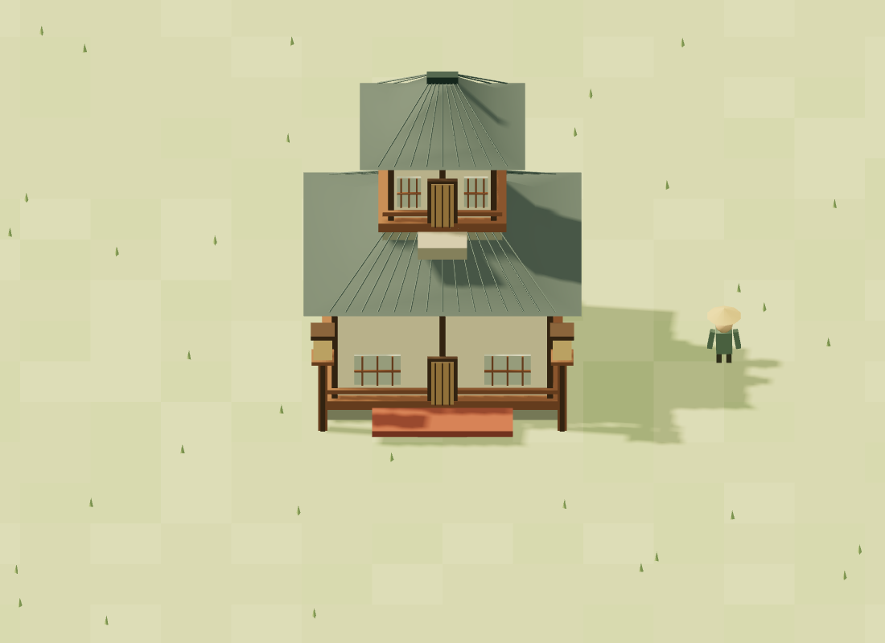
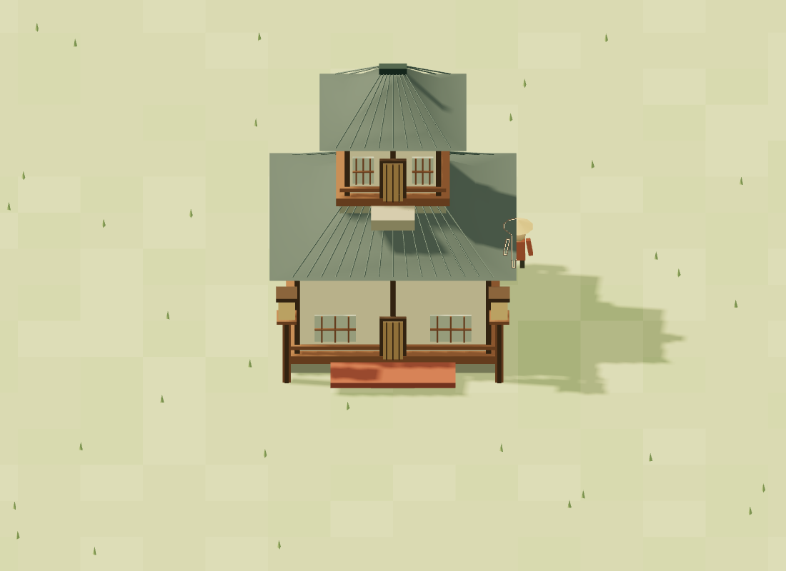
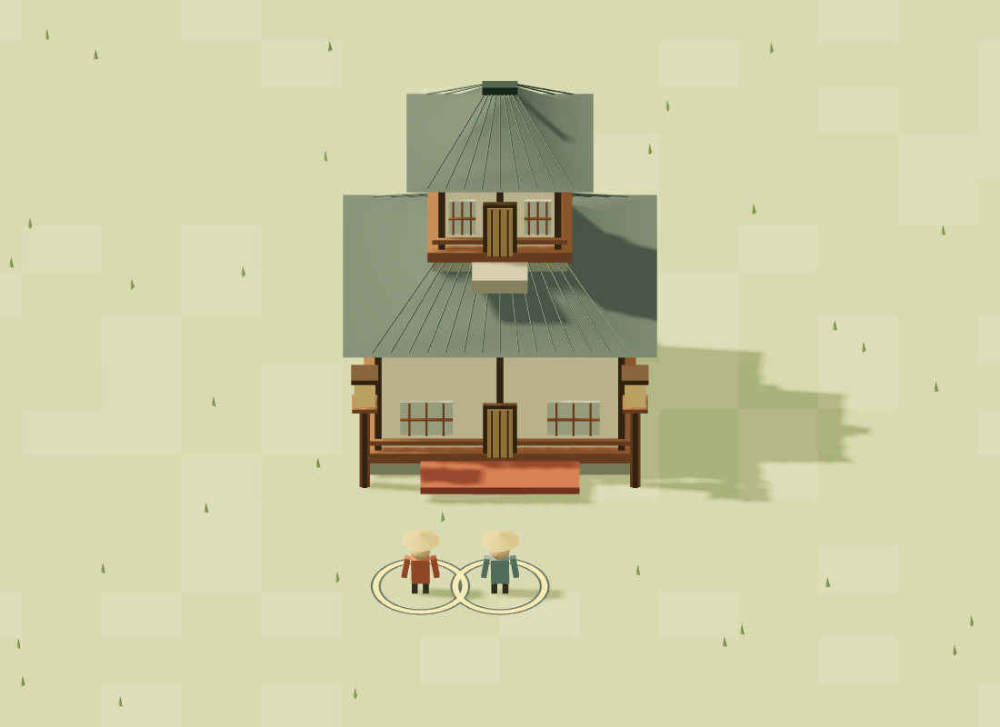

# Villagers behind buildings

Villagers now have a thin warm-ivory contour with a muted brown edge where placed building geometry hides them. The visible part stays unchanged. This applies equally to selected and unselected villagers; selection remains the existing ground ring. The outline is visual only: picking, rectangle selection, orders, navigation and save data are unchanged.

## Rendering contract

- The contour is inside the live villager silhouette, about two CSS pixels wide (including the dark edge). Hats, cargo, tools and walking/gathering poses participate only when their model parts are visible. Very small silhouettes can read as a small solid mark at distant zooms.
- Only pixels whose **nearest scene surface is a placed building** can show the contour, and that surface must be closer than the villager. Visible villagers never receive a permanent outline. Resources, terrain, roads, grid/selection overlays and placement ghosts cannot trigger it. A foreground non-building surface suppresses it. DOM interface panels remain above the canvas.
- This is a nearest-surface visibility cue, not a volumetric ray trace: objects between a foreground building and a hidden villager are not separately peeled apart. Overlapping villagers form the union of their nearest silhouettes; there is no individual outline inside an overlap. Separate silhouettes remain distinct.
- Actual meshes supply building depth, including rotation, construction scale and hidden unfinished roofs. There are no bounding-box occluders, raycast sampling gaps or duplicated animation rigs. Camera orbit, pan, zoom and canvas/device-pixel-ratio changes are reflected each frame.

`SceneEntities` only tags the render membership of its owned models when creating them. It retains all model/animation/replacement ownership. `VillageScene` owns `VillagerOcclusion`, calls it after animation and camera updates, and disposes it with the renderer. The effect holds no entity or world references, so removals and loaded worlds cannot leave stale silhouettes.

Two nearest-filtered render targets hold scene classification/depth and villager depth. One unlit mask renders the scene (white building, black everything else); a second renders only villagers. A fullscreen contour is blended over the original antialiased scene. The extra passes do not render shadows, clone models or allocate targets per villager/frame. Targets resize only with the drawing buffer and are released on disposal. Work scales with rendered geometry and screen area, not villager × building pairs. Empty villages/building lists skip the effect. Two RGBA8 + depth32 targets use about 16 bytes per drawing-buffer pixel; the renderer's existing 1.75 DPR cap still applies.

## Reproduce verification

Run the regular `npm test`, `npm run check`, `npm run format:check` and `npm run build` checks. For actual WebGL pixel checks, start `npm run dev`, then run:

```sh
# Supply an installed Playwright module and Chromium executable if not on defaults.
PLAYWRIGHT_MODULE=/absolute/path/to/playwright/index.mjs \
CHROMIUM_PATH=/usr/bin/chromium \
node tests/browser/occlusion.mjs
```

Playwright is an external verification prerequisite, not a game dependency. The fixture imports the real `VillageScene` and simulation/model code; it is not bundled into the application and needs no production test hooks. Each case compares pixels with and without the effect, then saves an actual scene screenshot. Artifacts and JSON results default to `/tmp/kigumi-occlusion` (`ARTIFACT_DIR` and `BASE_URL` can override destinations).

Coverage includes full/partial cover, multiple villagers, visible/hidden selected villagers, four rotations, unfinished buildings, reverse orbit, zoom, all five work poses, foreground non-building blockers, previews, replacement with reused IDs, repeated replacement allocation stability, resize/high DPI and a 200-villager render. Unit tests cover layer ownership, render-target reuse/disposal and renderer/scene state restoration even on failure. These are software WebGL/Chromium checks, not native Tauri or hardware-GPU validation.

## Captured scenes

Unmodified render, followed by the outline-enabled render (three hidden villagers and one visible villager):




Partial occlusion preserves the visible half of the villager:



Visible selected villagers keep their normal selection rings without an outline:


